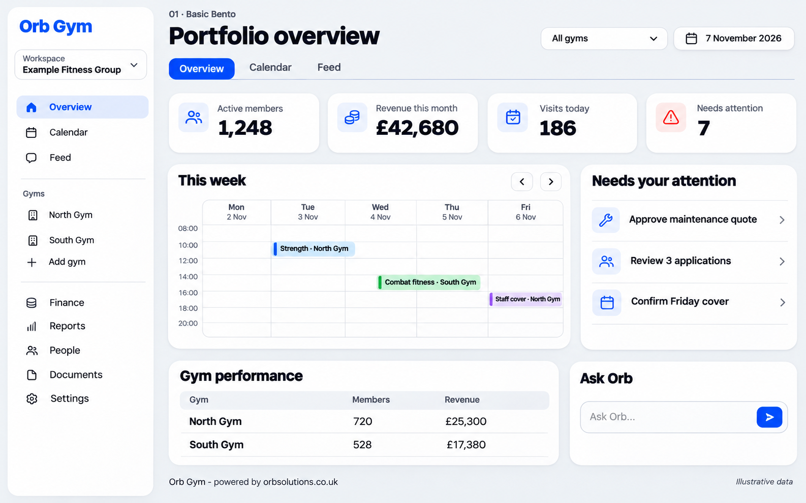
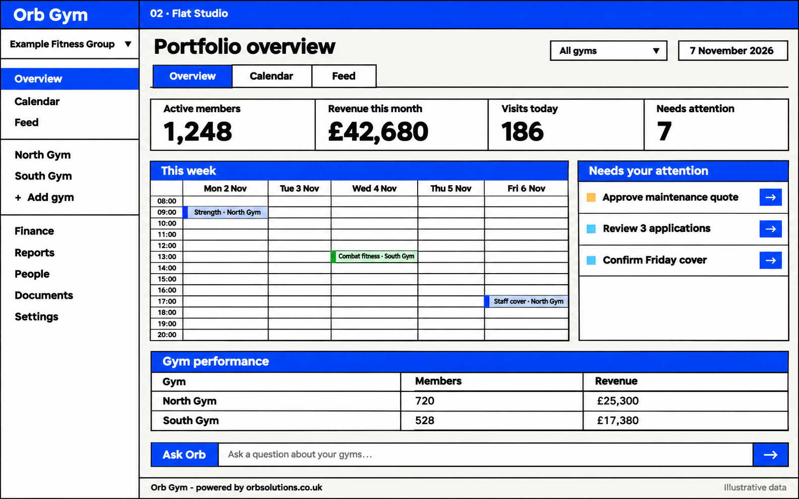
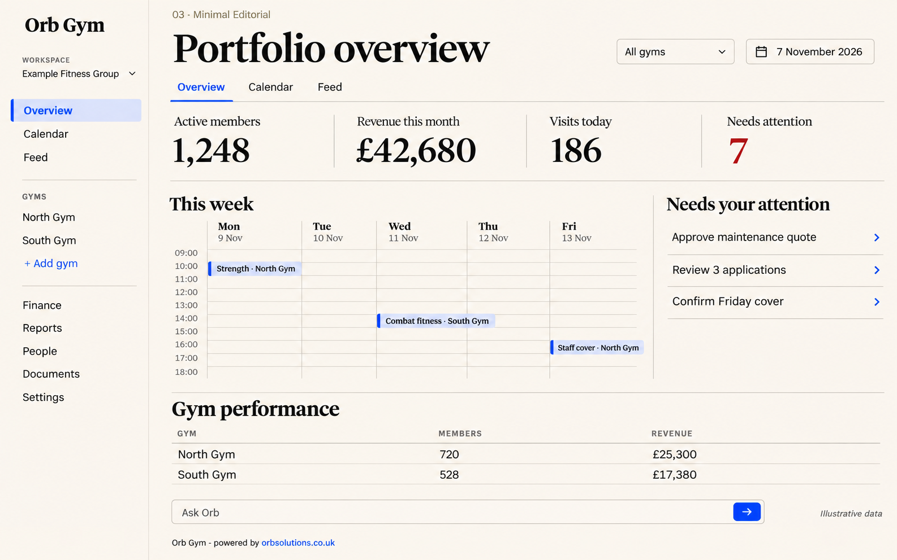
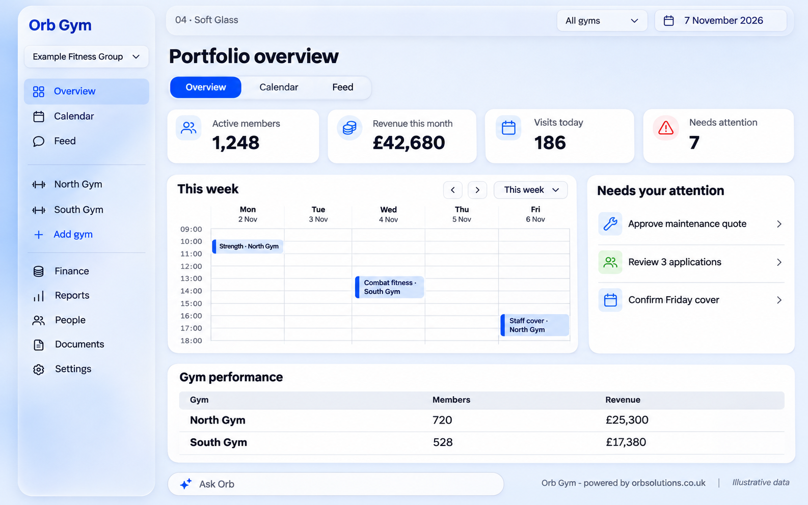
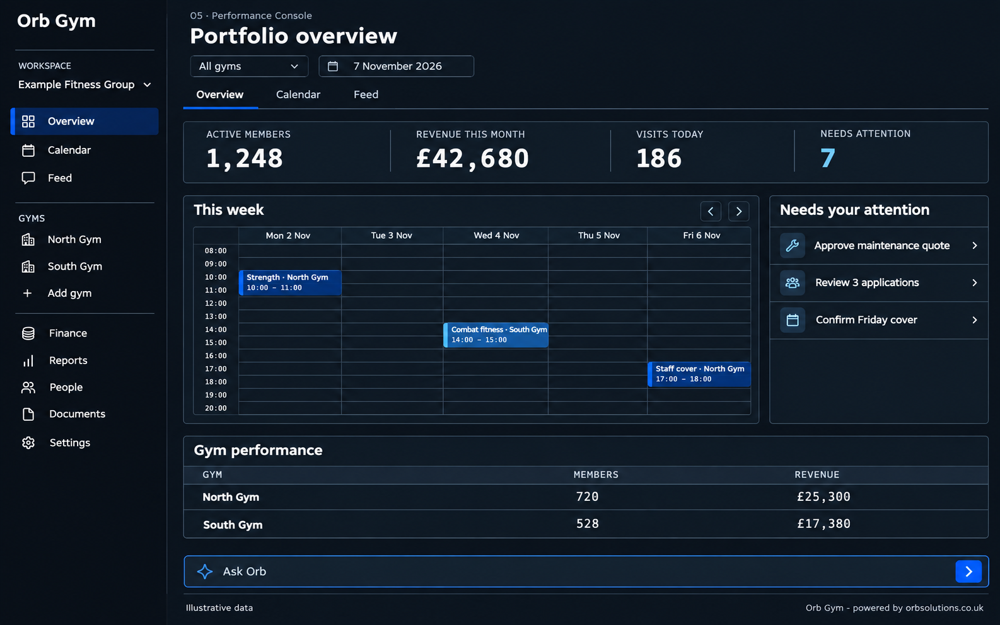

# Five comparable Orb Gym dashboard concepts — 0.24

These five new concepts illustrate the same owner portfolio dashboard and core fictional figures:1,248 members,£42,680 revenue, 186 visits, 7 attention items and two example gyms. They are the current style-comparison references. Earlier assets/ui-concepts images remain historical style exploration; this folder does not replace the supplied master logo.

**Default: Basic Bento01. Five styles are selectable company-wide (Neumorphic06 deferred); the five below are the ones with comparison imagery (Neumorphic06 has no rendered reference yet).** White-label activation is separate from preset selection; appearance cannot change permissions, business states or attribution. Company/gym branding and personal light/dark preferences follow the existing rules.

These images are visual references, not pixel-perfect specifications or implemented screens. The active written design rules, semantic/component tokens, workflow contracts, original brand assets and responsive/accessibility rules take precedence. Resolve deviations in implementation; do not copy unintended generated details.

## Known concept differences

Calendar dates, event placement and sample time slots vary across images; they are illustrative, not authoritative schedules. Some images add green/purple/cyan decorative category treatments: Basic uses cobalt as the sole decorative accent unless a validated company palette changes exposed mappings; status colours require actual semantic meaning. Editorial shows more serif numeric text than the written dense-table rules; operational tables retain the specified readable tabular treatment. Text wordmarks are placeholders and do not replace the supplied logo. Small rendering/typographic differences, strong Flat borders, gradients or ornamental controls are not additional product requirements.

Console is shown in dark mode and the other four in light mode. This comparison does not prove mode parity: all five still require both modes from the token contract and actual verification. No hover, keyboard, responsive, permission, contrast or performance testing is established by these static concepts. Use the separate annotated wireframes for hierarchy and the frontend master for behaviour.

## Basic Bento

Rounded modular cards, generous spacing and soft elevation.

## Flat Studio

Square edges, ruled bands, strong grid and no soft depth.

## Minimal Editorial

Warm neutrals, editorial serif headings and open sections.

## Soft Glass

Frosted navigation, soft depth and opaque main data surfaces.

## Performance Console

Dark precision grid, compact hierarchy and operational density.

