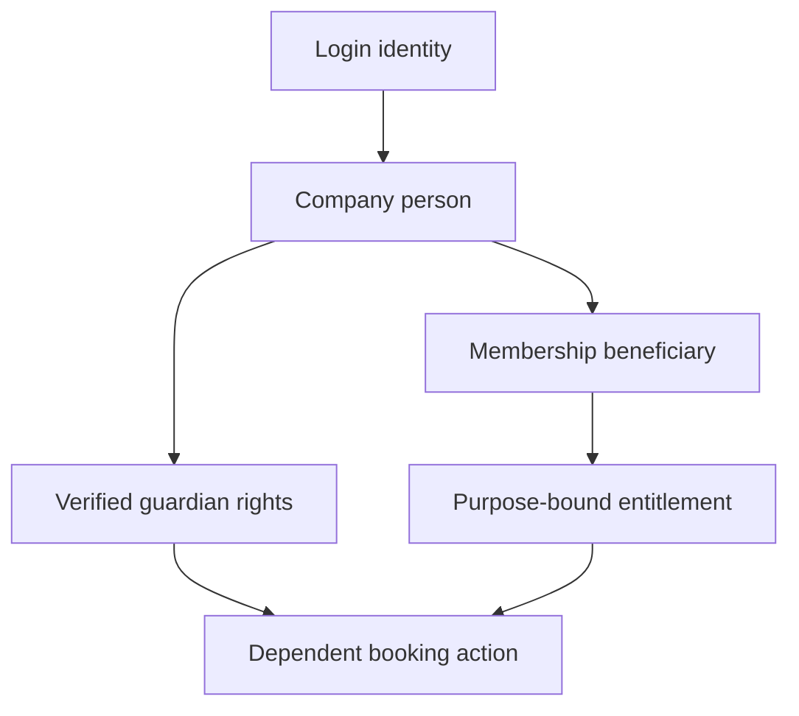
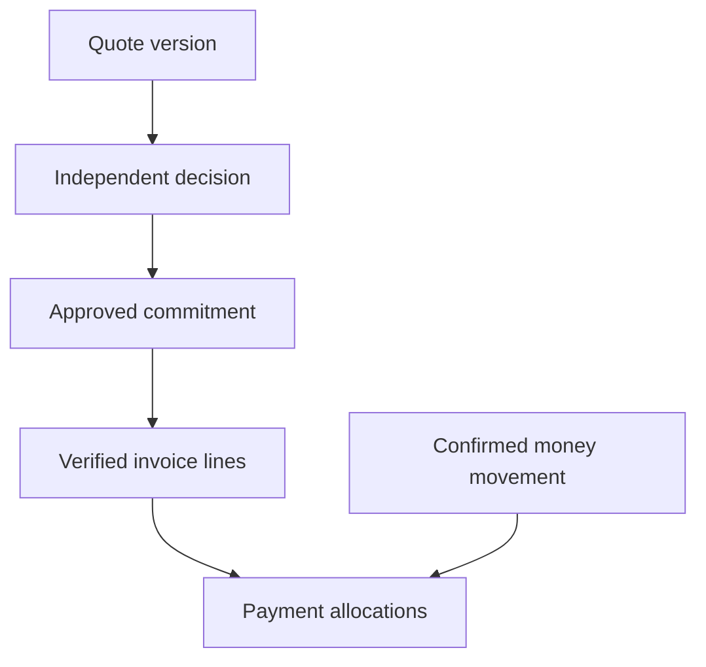
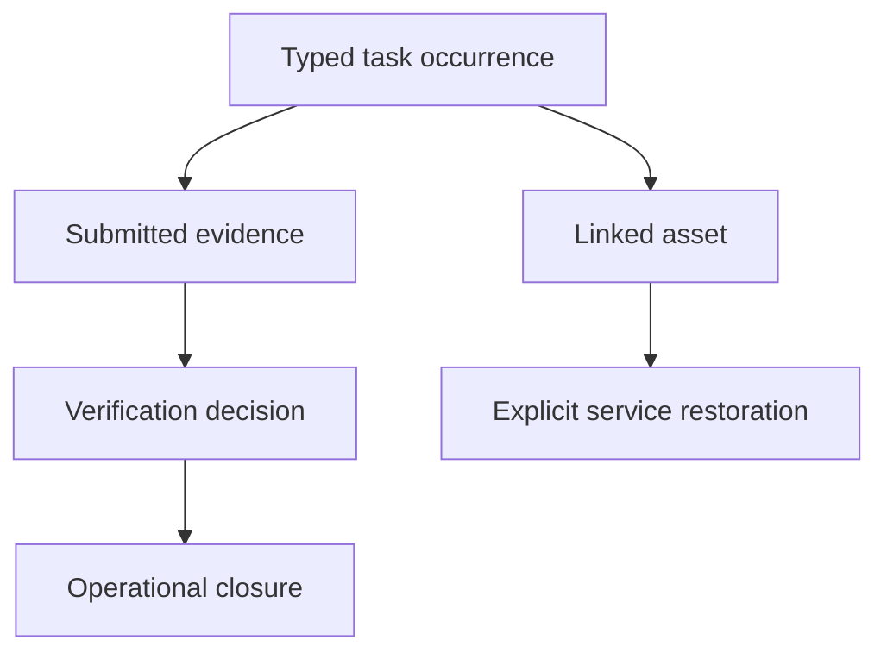

# Shared relationship diagrams

These diagrams show selected critical relationships, not every concrete table. See the canonical relationships.json for all listed core links and specialised contracts for further joins.

## Person, payer and participant

The person receiving service can differ from payer, booking actor and signer. Guardian relationship is not automatic membership or collection authority. Private company records remain distinct under one login.

## Commercial truth

Approval is not an invoice or cash. Invoice consumption reduces open commitment; allocated payments settle invoice balance without duplicating expense.

## Task and asset independence

Task closure does not automatically restore equipment or pay its supplier. Groups, children and dependencies preserve individual evidence and unique financial links.
