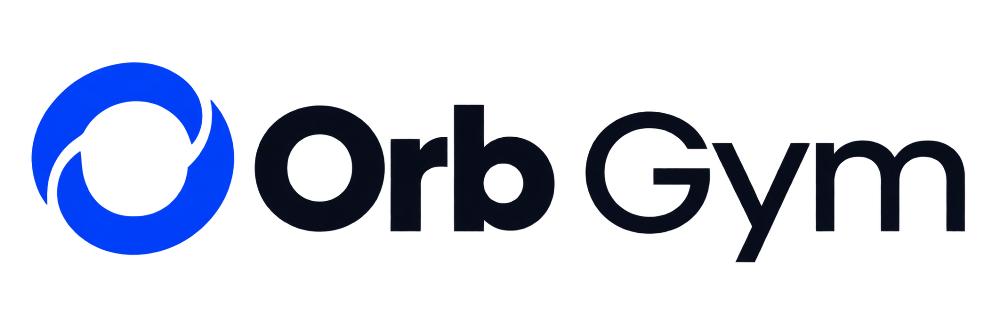

# design branding documents pages

Detailed extracted scope from baseline 0.17. Read with product-architecture.md and decisions-and-open-items.md. Each source reference is traceable; no requirement is removed by this grouping.

# Documents templates and white label control

<!-- OG-SRC-0125 -->
The Documents module designs and composes reusable document templates. Company Settings owns the shared company/gym branding configuration; Documents consumes those published settings when composing and generating documents. Other modules use the same brand source rather than independent copies.

<!-- OG-SRC-0126 -->
Support composing templates for contracts, membership agreements, invoices/receipts, letters, forms, policies/SOPs, reports and communication layouts. Templates combine controlled static content with typed dynamic fields linked to company, gym, billing entity, member, staff, transaction or job records. Provide a variable picker, required-field validation, document preview and role-controlled editing/review/publication. Never populate an unresolved field with invented text. Issuing invoices and collecting signatures remain governed by their source module, not by template editing.

<!-- OG-SRC-0127 -->
Template lifecycle: draft → preview/review → published → revised or archived. Keep versions, permissions, source data references and generated-document history. Existing issued/signed documents retain the content, data and brand version originally used. Uploading or replacing a template does not rewrite those records. Template publication does not imply legal approval of contract wording.

## Default identity and optional white labelling

<!-- OG-SRC-0128 -->
Every new workspace starts with the complete Orb Gym branding, supplied logo and default visual direction, including light/dark modes. A company logo upload alone does not activate white labelling. The company deliberately configures, previews and publishes the White label option in Company Settings to activate its identity.

<!-- OG-SRC-0129 -->
Once activated, the published company brand supplies application identity, member/contractor portals, landing pages, document and communication presentation, and assistant icon, with permitted gym overrides. Maintain one versioned brand configuration consumed by those surfaces. Preserve surface-specific design tokens and separately assigned legal/billing entities. Use the exact mandatory footer Orb Gym - powered by orbsolutions.co.uk on app and public pages; document/receipt attribution remains separately templated.

<!-- OG-SRC-0130 -->
Allow a company to disable white labelling and return to Orb Gym defaults without deleting its saved brand drafts, gym records or history. Previously issued documents retain their issued appearance. A gym override is effective only within the company’s enabled white-label policy; otherwise the default Orb Gym identity applies. Existing per-user theme preferences remain independent.

## Orb AI assistant identity

<!-- OG-SRC-0131 -->
The assistant’s display name is **Orb**. Before white labelling is activated, Orb uses the Orb Gym emblem. After activation, Orb uses the company’s approved icon mark derived from or supplied alongside its company logo. The name remains Orb; branding changes do not rename the assistant or change its permissions.

<!-- OG-SRC-0132 -->
Provide an icon upload/selection and preview in the Company Settings branding workspace. If a suitable separate mark is unavailable, prepare a candidate crop/extraction for review; do not distort the full wordmark or silently publish an unsuitable crop. Retain the Orb Gym icon as fallback until a company icon is approved. The assistant uses company identity even within a gym with a different logo, unless the founder later changes that policy.

<!-- OG-SRC-0133 -->
The same identity applies to assistant panels, messages and background insight cards. Clearly identify generated suggestions as coming from Orb; never present them as a human employee’s signed decision. Brand configuration cannot modify access controls, AI safety boundaries or financial approval rights.

<!-- OG-SRC-0134 -->
Acceptance: create a new workspace and verify Orb Gym defaults; compose and preview a template; upload company branding without activation and confirm defaults persist; publish white labelling and verify all surfaces plus Orb’s company icon; disable it and restore defaults; confirm old issued documents are unchanged.

# Design system and branding inheritance

## Design tokens as a platform foundation

## Five UI preset rules

<!-- OG-SRC-0135 -->
Orb Gym Basic 01 is the default for new workspaces. The generated previews illustrate direction only; their invented logos, sample dates/figures and stray PT label are not implementation requirements. Use the approved Orb Gym assets. All five presets support four journeys, every module, mobile adaptation, white labelling and light/dark modes.

### Orb Gym Basic 01

<!-- OG-SRC-0136 -->
Use the Bento structure with Orb Solutions’ actual design language. Source tokens: brand #044EFC; light background #F2F4F7; surface #FFFFFF; text #0B1220; muted #5B6472; border #E5E7EB; accent surface #E8F0FF. Use cobalt as the sole decorative accent. Semantic warnings/errors/success remain distinguishable; do not copy the generated preview’s purple/gold/teal decorative KPI palette.

<!-- OG-SRC-0137 -->
Typography: Inter Tight 700 headings with restrained negative tracking; Manrope 500 body and 600/700 controls. Website hero sizes apply to public heroes, not operational form headings. Source card radius 22px; button radius 14px; icon tile radius 14px; pills fully rounded. Source cards use white surfaces, subtle borders and soft shadows. Adapt marketing hover lifts to genuinely clickable app cards; static KPI cards must not imply clickability.

<!-- OG-SRC-0138 -->
Use a responsive modular grid with varied card spans, a prominent schedule and compact action summaries. Keep detail forms and tables orderly rather than making every field a card. Desktop sidebar expands gym modules; mobile uses the agreed navigation map. Source website buttons are 48px high with a 42px small variant; app dense controls may differ through explicit component tokens while preserving usable touch targets.

<!-- OG-SRC-0139 -->
Motion follows the source’s restrained easing cubic-bezier(.22,1,.36,1); use short feedback/transitions, disable ornamental motion under reduced-motion preference. No giant bouncing panels or automatic dashboard rearrangement.

<!-- OG-SRC-0140 -->
Proposed dark mapping: background #0B1220, surface #151E2E, raised surface #1D293B, text #F8FAFC, muted #B7C1D1 and border #334155. Retain cobalt identity, validate text/focus/action contrast separately and adjust semantic tokens where required. These dark values require visual/accessibility review.

### Flat Studio 02

<!-- OG-SRC-0141 -->
Use flat solid surfaces, strict alignment, sharp 0–4px radii and strong section rules. No glass, blurred backgrounds, gradients or decorative shadows. Use large sans-serif headings/numerals with a clear hierarchy and restrained operational body sizes. Initial tokens: background #F7F7F2, surface #FFFFFF, text #111111, brand #044EFC, strong rule #111111. Proposed dark: background #101010, surface #1A1A1A, text #F5F5F0, rule #737373.

<!-- OG-SRC-0142 -->
Organise metrics in a connected horizontal band; schedules and data tables form the main structure. Strong borders identify major groups, not every text line. Navigation selection uses a solid rectangular accent. Mobile stacks meaningful groups in reading order without retaining oversized poster typography. Motion is minimal, with immediate state changes and short fades. White labelling changes brand tokens without introducing rounded/glass components.

### Minimal Editorial 03

<!-- OG-SRC-0143 -->
Use generous spacing, typography-led hierarchy, thin dividers and predominantly card-free lists. Use an approved serif display face for major headings only (proposed Georgia fallback); retain a readable sans-serif body and tabular numerals for operational data. Initial tokens: background #FAF7F0, surface #FFFDFA, text #20201D, border #D8D5CD, accent #044EFC. Proposed dark: background #171817, surface #20221F, text #F4F1E8 and border #4C5048.

<!-- OG-SRC-0144 -->
Prefer aligned summaries, ledger rows, subtle links and quiet navigation; avoid thick rules, large coloured tiles and floating shadows. Forms still have explicit boundaries, validation and clear primary actions. Whitespace contracts on mobile to preserve usable content. Animation is limited to fades and gentle disclosure. Editorial refinement must not obscure operational urgency or decrease contrast.

### Soft Glass 04

<!-- OG-SRC-0145 -->
Use rounded grouped surfaces, translucent supporting navigation, pill selectors, soft elevation and depth hierarchy. Body uses system sans-serif for an iOS-inspired feel. Initial tokens: base #EFF4FC, opaque surface #FFFFFF, ink #152033 and accent #044EFC; proposed dark base #101725, opaque surface #1B273B and text #F5F8FF. Blur/opacity are component tokens with opaque fallback.

<!-- OG-SRC-0146 -->
Keep forms, financial tables and dense text on stable high-contrast surfaces. Limit translucency to selected navigation/overlays; avoid layering several blurred panes. Card radii 20–24px, control radii 12–16px, pills fully rounded. Use restrained depth and short transitions, never glowing neon. Respect reduced-motion/transparency preferences where available and maintain an opaque usable fallback. Mobile reduces visual layers and keeps touch controls prominent.

### Performance Console 05

<!-- OG-SRC-0147 -->
Use compact grids, narrow but labelled navigation, precise schedules, status chips and information-rich tables. Standard sans-serif body with monospace labels/IDs; do not set all long-form HR or member content in monospace. Radii 4–8px, small consistent gaps, subtle borders and little shadow. Dark baseline: background #0B1018, surface #141D29, text #F1F5F9, muted #A9B6C8, border #354255 and brand #044EFC. Light counterpart: background #EEF1F5, surface #FFFFFF, text #172133 and border #CCD3DD.

<!-- OG-SRC-0148 -->
Density is optional and role-appropriate: management can compare more records; member mobile screens remain comfortable and touch-friendly. Use colour for limited accents and semantic states, with labels/icons accompanying status. No neon glow or continuous animated decoration. Tables can scroll within a controlled region while summaries/forms reflow; mobile becomes prioritised lists and detail views, not a shrunken terminal.

### Preset validation and publication

<!-- OG-SRC-0149 -->
Each preset defines the same complete semantic/component token contract, including disabled/loading/error/focus/selected states, charts, forms, calendar, feed, job-card columns, POS, Documents and landing pages. Fonts, radii, density, surface treatment and layout variants change coherently. Do not hard-code one preset into a module.

<!-- OG-SRC-0150 -->
Validate all presets across owner, staff, member and contractor screens, light/dark modes, keyboard use, zoom, reduced motion, mobile navigation and long content. Present the same demo dataset for comparative previews. Allow draft/preview/publish/rollback and company/gym overrides through Company Settings; personal mode does not change the company’s published style. Final contrast and responsive checks are implementation acceptance requirements, not established by the concept images.

<!-- OG-SRC-0151 -->
From the first implementation, every visual component consumes a versioned token system. The complete application can change visual direction without rebuilding business workflows. Cover colour/semantic states, typography, spacing, density, sizes, radii, borders, shadows, elevation, icon treatments, navigation, cards, tables, forms, charts, calendars, hero sections and motion. Avoid hard-coded theme styling in product screens; document any necessary exceptions.

<!-- OG-SRC-0152 -->
The five style presets are full theme configurations, not accent-colour swaps. Light/dark modes are paired configurations for each preset. Theme switching preserves account permissions, navigation destinations, data, selected gym and unsaved work. Support preview across roles/devices/modes, save draft, publish, version history and rollback. Validate contrast, focus, reflow and usable control sizes before publishing; configurable branding cannot silently remove accessibility.

<!-- OG-SRC-0153 -->
Inheritance remains platform defaults → company workspace theme/brand → permitted gym overrides, with personal light/dark/system preference separate. Owners can reset overrides to inheritance. Theme changes publish as complete versions to avoid mixed configurations. Product UI, landing pages, member portals and document/email templates share brand sources but retain surface-specific tokens. Existing issued documents preserve their original brand version.

## White label configuration and management

<!-- OG-SRC-0154 -->
Company Settings contains Style and feel, Branding and White label, and Company details, with delegated gym settings where permitted. Manage logos, approved icons, names, colours, fonts, contact details and communication identity with inherited-result previews. Published settings apply throughout the app, portals, landing pages and communications. Orb Gym defaults remain active until white labelling is deliberately published. Custom domains and sender domains require separate configuration.

<!-- OG-SRC-0155 -->
Only authorised roles can publish company or gym branding; gym permissions cannot alter other gyms or company defaults. Validate uploaded assets and retain original/versioned derivatives. Branding never changes billing entity, data ownership or security scope.

## Landing page management

<!-- OG-SRC-0156 -->
Include a management module for company landing pages and individual gym pages, separate from the Orb Gym platform marketing site. Company owners manage their portfolio presentation; delegated gym managers can edit permitted gym content. Pages use the selected theme and brand inheritance from the outset.

<!-- OG-SRC-0157 -->
Manage hero text/media, gym logos/cards, facilities, services, coach introductions from published profiles, opening hours, contact/location, announcements, galleries, FAQs and joining calls to action. Configure section order/visibility and supported layout variants without introducing arbitrary scripts or hard-coded one-off pages. Offer mobile/desktop and light/dark previews where relevant.

<!-- OG-SRC-0158 -->
Membership prices and deals come from controlled plan/offer versions, and public timetables come from published class data. Do not maintain conflicting manual copies. Calls to action retain company/gym/offer context through enquiry/signup; owner platform signup remains a distinct journey. Public pages expose no private staff rota, member data, HR records or operational attachments.

<!-- OG-SRC-0159 -->
Page lifecycle: draft → preview → authorised publication → revision/archive, with version history and rollback. Record author, reviewer/publisher and publication time. Support page titles/descriptions, readable URLs, image alternative text, validated links and approved public contact details. Domain mapping, search indexing and any analytics/consent integration need delivery configuration.

<!-- OG-SRC-0160 -->
Acceptance: switch the complete app between contrasting presets; publish company branding with one gym override; verify all four role experiences and both modes; roll back safely; edit and publish a gym landing page; confirm price/timetable consistency and correct signup context; test public/private isolation. These requirements are foundational scope, not post-launch cosmetic work.

<!-- OG-SRC-0161 -->
Orb Gym provides the default product identity. The company can upload its logo and details at the first platform layer; each gym can use those defaults or supply its own logo, name, contacts and approved theme overrides. Keep the exact footer Orb Gym - powered by orbsolutions.co.uk throughout the white-labelled app and public pages.

## Default Orb Gym identity and design reference

<!-- OG-SRC-0162 -->

<!-- OG-SRC-0163 -->
The supplied Orb Gym logo is the canonical default platform lockup: a blue orb emblem and dark wordmark. Preserve its proportions and artwork. Maintain separate product, company and gym brand assets; a company logo must not overwrite the Orb Gym original. Version derived sizes and report assets so existing documents retain their issued identity.

<!-- OG-SRC-0164 -->
The default Orb Gym Basic 01 direction is grounded in the HTML and stylesheet retrieved from [Orb Solutions](https://orbsolutions.co.uk) on 6 November 2026, including [styles.css version 10](https://orbsolutions.co.uk/assets/styles.css?v=10). Confirmed source values include Inter Tight headings, Manrope body, cobalt #044EFC, background #F2F4F7, white surfaces, ink #0B1220 and 22px cards. The website is the visual source, adapted to operational app layouts rather than copying marketing-page proportions. Dark-mode values and app-specific dimensions below are proposed mappings, not extracted website tokens.

<!-- OG-SRC-0165 -->
This default direction coexists with the company-specific branded presentation and the five selectable style presets. Company and gym configuration can override permitted presentation tokens while keeping shared usability and the exact footer Orb Gym - powered by orbsolutions.co.uk.

<!-- OG-SRC-0166 -->
Both light and dark modes are required across management, staff and member experiences and all presets. Each user can save light, dark or system preference. Define background, surface, text, border, icon, focus and action tokens for each mode. Keep semantic status colours distinct from decorative accents. The supplied dark wordmark needs a suitable light surface in dark mode until an approved reversed asset exists; do not invert or redraw it automatically.

<!-- OG-SRC-0167 -->
Validate logo legibility, colour contrast, focus and mobile reflow in both modes. The original asset is preserved as a native Page attachment; its visual rendering still requires preview verification.

<!-- OG-SRC-0168 -->
| Style preset | Distinct visual treatment |
|---|---|
| Orb Gym Basic 01 | Default Bento layout using Orb Solutions typography, cobalt, white/cool-grey surfaces and rounded cards. |
| Flat Studio 02 | Crisp surfaces, solid colour blocks and restrained depth. |
| Minimal Editorial 03 | Typography-led hierarchy, generous spacing and fine dividers. |
| Soft Glass 04 | Rounded controls, grouped surfaces and subtle depth. |
| Performance Console 05 | Compact operational layouts, strong contrast and structured tables. |

<!-- OG-SRC-0169 -->
Token layers cover foundations, semantic colours, components and brand surfaces. Expose controlled settings for buttons, icons, typography, backgrounds, navigation and hero treatments. All presets support the same workflows. Allow preview, save, publish and restore, with light/dark previews and readability checks.

<!-- OG-SRC-0170 -->
Inheritance order: platform default → company published theme → permitted gym override. Personal light/dark/system mode applies independently and follows the user. Personal preferences do not overwrite company branding. Changing style preserves records and work in progress.

<!-- OG-SRC-0171 -->
Invoice and contract identity uses a configured legal/billing entity, not whichever decorative logo was last uploaded. Issued invoices and signed contracts freeze the identity/template version used.

<!-- OG-SRC-0172 -->
Desktop uses the expandable left sidebar. iPad/tablet and mobile use a gym switcher and role-specific navigation. Reception prioritises fast member lookup, check-in and POS; instructors prioritise registers; cleaning staff prioritise job sheets. Management retains access to approvals and cross-gym oversight on mobile.

# Automatic gym landing pages and owner assistant

<!-- OG-SRC-0173 -->
Adding a gym automatically creates its linked page, card and navigation entry on the company’s landing site. Use gym Settings as the source for logo, name, description, address, opening hours, contacts, facilities, services and social links. This does not publish customer gyms on the central Orb Gym marketing website.

<!-- OG-SRC-0174 -->
Draft/incomplete/private gyms remain unpublished. Once the owner marks a gym public, validated public details appear automatically and subsequent changes propagate without maintaining duplicate content. Preserve the last valid page if an update fails; archive/unpublish removes active promotion while preserving history and handling existing links.

<!-- OG-SRC-0175 -->
Gym Settings accepts brand guidelines and approved social/brand assets and URLs. Orb can extract suggested colours, fonts, images and descriptions into a preview with source references. Preserve manual edits on refresh; uncertain or conflicting values require review. Social links alone do not authorise private account access or republishing third-party media. Use supported authorised integrations where needed. Uploaded private guidelines and internal information must not become publicly downloadable. Logo/guideline upload does not itself activate white labelling; apply the existing company/gym branding rules and defaults.

## Orb for the owner

<!-- OG-SRC-0176 -->
The owner has an interactive Orb assistant across authorised gyms for reports, analysis, advice and execution. Orb can produce sourced reports, compare performance, explain trends, investigate exceptions and recommend next actions. Responses identify reporting period, source records and material missing information.

<!-- OG-SRC-0177 -->
Execution uses the same authorised business commands as the app. A clear owner instruction can authorise supported routine actions such as creating/assigning tasks, generating reports, preparing rotas and updating permitted records. Record the gym, affected records, command and outcome; return links to results. Avoid repeat confirmation for routine work already authorised.

<!-- OG-SRC-0178 -->
Payments/refunds, contracts/signatures, access suspension/deletion, external publication and consequential rota changes follow their established approval rules. Prepare concrete actions for any required decision; never invent authority or bypass RBAC. Automatic gym-page updates follow the owner’s explicit public-status configuration.

<!-- OG-SRC-0179 -->
Use operation IDs and outcome receipts to prevent duplicates on retries. Explain partial success and failures. Recheck access on pending work; keep normal tools usable if AI fails. AI advice remains distinct from verified facts and recorded approvals.

<!-- OG-SRC-0180 -->
Acceptance: create and publish a gym, verify page/card/logo/detail propagation, preview brand extraction without overwriting manual choices, prevent private-data publication, generate a sourced owner report, execute an authorised task assignment and verify approval/duplicate safeguards.

