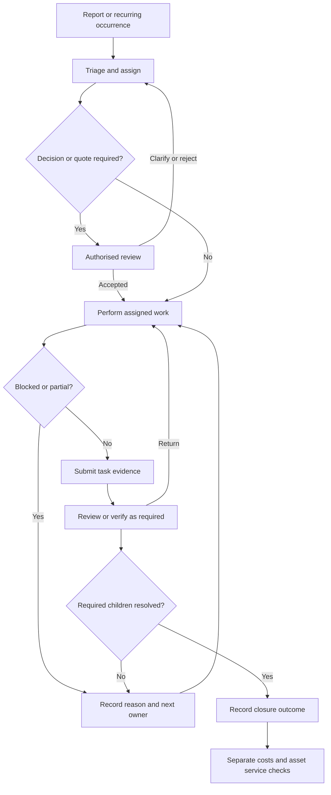

# Shared Tasks — Cleaning, Maintenance and Admin

Repository 0.21. 21 source-backed primary and exception workflows for this domain. IDs are stable feature/workflow references, not delivery-card sequence numbers.

## Sources and receiving specifications

[05-task-engine-facilities-contractors.md](../modules/05-task-engine-facilities-contractors.md)

[tasks-assets-contractors](../../spec/tasks-assets-contractors.md)

Planned cross-module acceptance: AC21, AC22, AC23, AC24, AC25, AC44. Decision references: GAP09, GAP11, GAP13, GAP15. Read the [common contract](README.md#common-workflow-contract).

## Module surface, state boundaries and ownership

Same top-details/lower-activity-left/record-tabs-right item card across cleaning, maintenance and admin. On compact layouts use Details/Activity/Records, preserving identity/draft.

Reported/triaged/assigned/awaiting decision or quote/scheduled/in progress/blocked/completion submitted/verified closed; reopen/cancel remain historical. These are business checkpoints, not a required single enum on every task subtype.

Task owner → assigned operative/cleaner/admin/contractor → authorised reviewer/approver → finance or service-status owner where applicable.

The lifecycle words below are business checkpoints. The builder must resolve exact enum values and actor/action/field tables before implementation, with all open policy branches retained. Existing authority and source-specific review rules apply; no new approval gate or access right is created merely by this catalogue.

## WF-TASK-01

**FEAT-TASK-01 — Common task creation and triage**

| Contract | Required behaviour |
|---|---|
| Actor / trigger | Authorised requester reports work for a gym/area/asset |
| Preconditions | Explicit workspace, type, description, audience and responsible queue |
| Ordered journey / checkpoints | Draft → submit → triage → assign owner/priority/dates → track outcome |
| Source records / result / handoff | One task ID, original evidence, typed history and next responsible person; calendar links to this task |
| Exception / decision branch | Duplicate report links to existing work; missing information returns for clarification; status does not imply approval |

Local acceptance: demonstrate the stated result and its exception branch, with current scoped access and truthful committed/pending/failed state. Apply the [common acceptance](README.md#common-acceptance-for-every-workflow) and AC21, AC22, AC23, AC24, AC25, AC44 where relevant. Record policy-dependent branches as blocked until their referenced choice is resolved.

## WF-TASK-02

**FEAT-TASK-02 — Cleaning job-sheet template**

| Contract | Required behaviour |
|---|---|
| Actor / trigger | Cleaner/supervisor with delegated scheduling rights prepares a recurring job |
| Preconditions | Gym/area, instructions, child checklist, evidence and verification requirements |
| Ordered journey / checkpoints | Draft template → validate → authorise where required → activate recurrence → generate dated sheet |
| Source records / result / handoff | Template version and separate scheduled occurrences; opening/closing/safety check templates use the same engine |
| Exception / decision branch | Template edits affect defined future occurrences, never overwrite completed evidence; no independent cleaning task database |

Local acceptance: demonstrate the stated result and its exception branch, with current scoped access and truthful committed/pending/failed state. Apply the [common acceptance](README.md#common-acceptance-for-every-workflow) and AC21, AC22, AC23, AC24, AC25, AC44 where relevant. Record policy-dependent branches as blocked until their referenced choice is resolved.

## WF-TASK-03

**FEAT-TASK-03 — Cleaning execution and proof**

| Contract | Required behaviour |
|---|---|
| Actor / trigger | Assigned cleaner opens the scheduled job sheet |
| Preconditions | Current assignment and exact dated child tasks |
| Ordered journey / checkpoints | Open sheet → complete each task → add required photo/note → mark complete/partial/blocked/not completed → submit |
| Source records / result / handoff | Evidence belongs to each task, not only the parent; manager can see outstanding counts |
| Exception / decision branch | Failed upload remains pending; partial/blocked work cannot turn the whole sheet green; delegated evidence policy determines mandatory proof |

Local acceptance: demonstrate the stated result and its exception branch, with current scoped access and truthful committed/pending/failed state. Apply the [common acceptance](README.md#common-acceptance-for-every-workflow) and AC21, AC22, AC23, AC24, AC25, AC44 where relevant. Record policy-dependent branches as blocked until their referenced choice is resolved.

## WF-TASK-04

**FEAT-TASK-04 — Cleaning verification and remedial follow-up**

| Contract | Required behaviour |
|---|---|
| Actor / trigger | Authorised reviewer checks a submitted cleaning task |
| Preconditions | Submission and required evidence are available |
| Ordered journey / checkpoints | Review → verify or return → cleaner resolves exceptions → resubmit → record outcome |
| Source records / result / handoff | Staff-reported completion differs from manager verification; create linked follow-up work for defects/shortages |
| Exception / decision branch | Return preserves earlier evidence and reason; AI image suggestion cannot certify cleaning quality |

Local acceptance: demonstrate the stated result and its exception branch, with current scoped access and truthful committed/pending/failed state. Apply the [common acceptance](README.md#common-acceptance-for-every-workflow) and AC21, AC22, AC23, AC24, AC25, AC44 where relevant. Record policy-dependent branches as blocked until their referenced choice is resolved.

## WF-TASK-05

**FEAT-TASK-05 — Maintenance fault and asset scan**

| Contract | Required behaviour |
|---|---|
| Actor / trigger | Staff/member in permitted reporting view scans equipment QR or reports a fault |
| Preconditions | Asset reference or manual location, photos/description and audience |
| Ordered journey / checkpoints | Scan/lookup → show existing faults → submit → triage → assign urgency and responsible person |
| Source records / result / handoff | Linked asset/fault/task and permitted status; QR identifies equipment and does not grant rights |
| Exception / decision branch | Damaged QR uses manual lookup; urgent concern escalates under assigned authority, not AI certification |

Local acceptance: demonstrate the stated result and its exception branch, with current scoped access and truthful committed/pending/failed state. Apply the [common acceptance](README.md#common-acceptance-for-every-workflow) and AC21, AC22, AC23, AC24, AC25, AC44 where relevant. Record policy-dependent branches as blocked until their referenced choice is resolved.

## WF-TASK-06

**FEAT-TASK-06 — Contractor assignment and visits**

| Contract | Required behaviour |
|---|---|
| Actor / trigger | Manager chooses contractor for a triaged job |
| Preconditions | Supplier scope and necessary shared job/asset/location data |
| Ordered journey / checkpoints | Assign → deliver notification → contractor accepts/declines/clarifies → propose visit → schedule |
| Source records / result / handoff | Assignment, delivery and acceptance states; permitted visit appears in calendar |
| Exception / decision branch | Declined/unacknowledged work stays owned by management; tagging contractor alone does not grant job access |

Local acceptance: demonstrate the stated result and its exception branch, with current scoped access and truthful committed/pending/failed state. Apply the [common acceptance](README.md#common-acceptance-for-every-workflow) and AC21, AC22, AC23, AC24, AC25, AC44 where relevant. Record policy-dependent branches as blocked until their referenced choice is resolved.

## WF-TASK-07

**FEAT-TASK-07 — Quote and variation approval**

| Contract | Required behaviour |
|---|---|
| Actor / trigger | Contractor submits costed proposal or changes scope |
| Preconditions | Supplier, versioned scope/lines/tax/validity and authorised approver |
| Ordered journey / checkpoints | Quote submitted → request decision → approve/reject/clarify → record commitment → variation requires applicable new decision |
| Source records / result / handoff | Same quote/decision IDs project into feed and record tabs; version considered by approver retained |
| Exception / decision branch | Contractor cannot self-approve; edited scope/amount cannot silently inherit an obsolete approval; limits remain configurable |

Local acceptance: demonstrate the stated result and its exception branch, with current scoped access and truthful committed/pending/failed state. Apply the [common acceptance](README.md#common-acceptance-for-every-workflow) and AC21, AC22, AC23, AC24, AC25, AC44 where relevant. Record policy-dependent branches as blocked until their referenced choice is resolved.

## WF-TASK-08

**FEAT-TASK-08 — Work completion and asset restoration**

| Contract | Required behaviour |
|---|---|
| Actor / trigger | Operative/staff submits maintenance work evidence |
| Preconditions | Assigned job, approved work where required and outstanding faults visible |
| Ordered journey / checkpoints | Work update → completion submitted → manager verifies/returns → job closure → separate asset-service decision |
| Source records / result / handoff | Job verification, asset operating state and costs are distinct; repair history retained |
| Exception / decision branch | Another open fault can keep asset restricted; invoice payment cannot automatically certify equipment safe |

Local acceptance: demonstrate the stated result and its exception branch, with current scoped access and truthful committed/pending/failed state. Apply the [common acceptance](README.md#common-acceptance-for-every-workflow) and AC21, AC22, AC23, AC24, AC25, AC44 where relevant. Record policy-dependent branches as blocked until their referenced choice is resolved.

## WF-TASK-09

**FEAT-TASK-09 — Administrative task journey**

| Contract | Required behaviour |
|---|---|
| Actor / trigger | Authorised user creates non-cleaning/non-maintenance work |
| Preconditions | Same task form with admin-specific fields and audience |
| Ordered journey / checkpoints | Create → triage/assign → work/update → request applicable decision → submit → verify/close |
| Source records / result / handoff | Same core task ID/feed/evidence/hierarchy, optional documents/financial links |
| Exception / decision branch | Missing information, blocked dependencies and rejected decisions stay explicit; no separate admin pipeline implementation |

Local acceptance: demonstrate the stated result and its exception branch, with current scoped access and truthful committed/pending/failed state. Apply the [common acceptance](README.md#common-acceptance-for-every-workflow) and AC21, AC22, AC23, AC24, AC25, AC44 where relevant. Record policy-dependent branches as blocked until their referenced choice is resolved.

## WF-TASK-10

**FEAT-TASK-10 — Parent and child task management**

| Contract | Required behaviour |
|---|---|
| Actor / trigger | Manager divides a task into accountable child work |
| Preconditions | Existing parent and permitted child scope/owners/dates |
| Ordered journey / checkpoints | Add children → validate acyclic parentage → assign → track each proof → derive parent progress → verify closure |
| Source records / result / handoff | Child states/evidence remain independent; parent shows completed/outstanding/waived counts |
| Exception / decision branch | Required unfinished/unverified children prevent full completion; cancellation/waiver requires applicable authority and reason |

Local acceptance: demonstrate the stated result and its exception branch, with current scoped access and truthful committed/pending/failed state. Apply the [common acceptance](README.md#common-acceptance-for-every-workflow) and AC21, AC22, AC23, AC24, AC25, AC44 where relevant. Record policy-dependent branches as blocked until their referenced choice is resolved.

## WF-TASK-11

**FEAT-TASK-11 — Grouping and joined job sheets**

| Contract | Required behaviour |
|---|---|
| Actor / trigger | Authorised coordinator groups existing independent tasks |
| Preconditions | Stable task IDs and each task’s audience/history |
| Ordered journey / checkpoints | Select tasks → group/link work package → schedule/assign as permitted → report rollup → ungroup if needed |
| Source records / result / handoff | Grouping differs from parentage/dependency; originals and history survive |
| Exception / decision branch | Never clone costs/evidence to imply multiple payments; inaccessible children are not exposed through rollup |

Local acceptance: demonstrate the stated result and its exception branch, with current scoped access and truthful committed/pending/failed state. Apply the [common acceptance](README.md#common-acceptance-for-every-workflow) and AC21, AC22, AC23, AC24, AC25, AC44 where relevant. Record policy-dependent branches as blocked until their referenced choice is resolved.

## WF-TASK-12

**FEAT-TASK-12 — Dependencies and blocked work**

| Contract | Required behaviour |
|---|---|
| Actor / trigger | Task owner records prerequisite or external blocker |
| Preconditions | Valid scoped tasks and named next owner/action |
| Ordered journey / checkpoints | Link dependency → reject cycle → show blocked reason → resolve prerequisite → re-evaluate readiness |
| Source records / result / handoff | Block/unblock events and next action; other independent work can proceed |
| Exception / decision branch | Parentage is not automatically a blocker; no silent auto-close or invented completion on a date |

Local acceptance: demonstrate the stated result and its exception branch, with current scoped access and truthful committed/pending/failed state. Apply the [common acceptance](README.md#common-acceptance-for-every-workflow) and AC21, AC22, AC23, AC24, AC25, AC44 where relevant. Record policy-dependent branches as blocked until their referenced choice is resolved.

## WF-TASK-13

**FEAT-TASK-13 — Recurring schedule changes and overdue work**

| Contract | Required behaviour |
|---|---|
| Actor / trigger | Delegated scheduler changes repeat pattern or sees missed occurrence |
| Preconditions | Gym timezone, template version, published assignments and dates |
| Ordered journey / checkpoints | Preview future dates → create distinct occurrences/children → notify current assignees → flag overdue → resolve |
| Source records / result / handoff | Occurrence history, corrected recurrence and source calendar links; escalation policy explicit |
| Exception / decision branch | Retry/DST cannot generate duplicates; historic completed sheets remain unchanged; reminder timing is unresolved configuration |

Local acceptance: demonstrate the stated result and its exception branch, with current scoped access and truthful committed/pending/failed state. Apply the [common acceptance](README.md#common-acceptance-for-every-workflow) and AC21, AC22, AC23, AC24, AC25, AC44 where relevant. Record policy-dependent branches as blocked until their referenced choice is resolved.

## WF-TASK-14

**FEAT-TASK-14 — Card feed, attachments and structured tabs**

| Contract | Required behaviour |
|---|---|
| Actor / trigger | Authorised participant updates any task/case |
| Preconditions | Current item, audience and action rights |
| Ordered journey / checkpoints | Open top summary → post note/reply/attachment/mention or typed decision/quote/invoice → index records → follow outcome |
| Source records / result / handoff | Top details; lower activity left and records right; compact Details/Activity/Records; one underlying record per event |
| Exception / decision branch | Note is not approval; attachment pending/failed is truthful; member/vendor/internal audiences do not merge |

Local acceptance: demonstrate the stated result and its exception branch, with current scoped access and truthful committed/pending/failed state. Apply the [common acceptance](README.md#common-acceptance-for-every-workflow) and AC21, AC22, AC23, AC24, AC25, AC44 where relevant. Record policy-dependent branches as blocked until their referenced choice is resolved.

## WF-TASK-15

**FEAT-TASK-15 — Invoice, cost allocation and payment**

| Contract | Required behaviour |
|---|---|
| Actor / trigger | Supplier/finance records cost on approved work |
| Preconditions | Source job/quote/commitment, invoice details and applicable authority |
| Ordered journey / checkpoints | Invoice submit → match/discrepancy review → approve where required → reconcile partial/full payment/credit → report |
| Source records / result / handoff | Estimate, commitment, invoiced and paid amounts separate; group/asset/gym costs count each financial record once |
| Exception / decision branch | Uploaded invoice is not proof of payment; variation, duplicate invoice or allocation error remains a finance exception |

Local acceptance: demonstrate the stated result and its exception branch, with current scoped access and truthful committed/pending/failed state. Apply the [common acceptance](README.md#common-acceptance-for-every-workflow) and AC21, AC22, AC23, AC24, AC25, AC44 where relevant. Record policy-dependent branches as blocked until their referenced choice is resolved.

## WF-TASK-16

**FEAT-TASK-16 — Reopen, cancel and retain task history**

| Contract | Required behaviour |
|---|---|
| Actor / trigger | Authorised owner reviews unsuccessful resolution or cancellation |
| Preconditions | Current task, outcome, remaining children/financial obligations |
| Ordered journey / checkpoints | Explain reason → reopen/cancel under authority → review assignees/dependencies → notify → retain earlier outcome |
| Source records / result / handoff | Audited status transition and continued original feed/asset history |
| Exception / decision branch | Reopening cannot erase approval/cost/evidence; cancellation does not silently close child tasks or revoke a paid liability |

Local acceptance: demonstrate the stated result and its exception branch, with current scoped access and truthful committed/pending/failed state. Apply the [common acceptance](README.md#common-acceptance-for-every-workflow) and AC21, AC22, AC23, AC24, AC25, AC44 where relevant. Record policy-dependent branches as blocked until their referenced choice is resolved.

## WF-TASK-17

**FEAT-TASK-17 — Member equipment announcement**

| Contract | Required behaviour |
|---|---|
| Actor / trigger | Manager changes asset availability |
| Preconditions | Explicit asset state and approved member-facing content |
| Ordered journey / checkpoints | Draft restriction notice → authorise publication → show gym/equipment/alternatives → service restored → update/resolve notice |
| Source records / result / handoff | Announcement links the asset but excludes internal quotes/files; relevant class/resource conflicts flagged |
| Exception / decision branch | Fault report alone does not publish or cancel classes; restoration requires authorised service decision |

Local acceptance: demonstrate the stated result and its exception branch, with current scoped access and truthful committed/pending/failed state. Apply the [common acceptance](README.md#common-acceptance-for-every-workflow) and AC21, AC22, AC23, AC24, AC25, AC44 where relevant. Record policy-dependent branches as blocked until their referenced choice is resolved.

## Shared task checkpoint diagram

This view illustrates the already specified task engine. Review/cost gates are conditional on type/policy; parent and financial/service completion are separate checks.

## WF-TASK-18

**FEAT-TASK-07 — Approver or task owner unavailable while a decision is pending**

Exception/lifecycle subflow of WF-TASK-07; review finding GR05. Existing source-grounded behaviour is clarified; new policy alternatives are not approved.

| Contract | Required behaviour |
|---|---|
| Actors/trigger | Contractor submits costed proposal or changes scope |
| Preconditions | Current job/quote/version/expiry, pending decision, current role grants and authorised reassignment/delegation route. |
| Authoritative outcome/handoff | Keep the task/approval owned; reassign to an already authorised suitable reviewer or escalate to an authorised owner; revalidate quote/version before any decision. |
| Exception/policy boundary | Sending a reminder or tagging another person cannot grant approval power. Contractor cannot approve their own quote. Backup rules/limits and conflicts remain a decided permission policy. |

Business checkpoints below describe behaviour, not mandatory API enum spellings. Each decision uses current delegated authority.

| Actor | Before/after checkpoint | Guard/action | Record and next owner | Failure/return path |
|---|---|---|---|---|
| Task/decision coordinator | Pending → unavailable owner detected | Identify revoked/left/absent role or unowned deadline without exposing HR reason | Blocked/overdue state and management next action | Do not auto-approve or silently drop the request because its owner changed |
| Authorised manager | Unowned → delegated within existing authority or escalated | Choose a permitted reviewer and check any decision/conflict limits | Recorded reassignment/delegation and scoped notification | No available approver leaves a visible owner-level exception; no privilege escalation |
| New authorised reviewer | Assigned → decision-ready | Check current quote scope/amount/validity/version and attached evidence | Fresh review context and appropriate approval/rejection | Expired/materially revised quote returns for clarification/new approval |
| Source command | Decision-ready → recorded outcome | Commit authorised decision and linked commitment exactly once | Preserved old assignments plus actor/time/reason/version; next task/finance owner | Concurrent or repeated approvals cannot create duplicate commitments or bypass amount limits |

Planned acceptance: AC21, AC22, AC23, AC24, AC25, AC44, AC61. Operational decisions: DEC-GR-01. See [decision discussion](../decisions/operational-decisions.md).

## WF-TASK-19

**FEAT-TASK-13 — Change a recurring template with already-issued or active work**

Exception/lifecycle subflow of WF-TASK-13; review finding GR06. Existing source-grounded behaviour is clarified; new policy alternatives are not approved.

| Contract | Required behaviour |
|---|---|
| Actors/trigger | Delegated scheduler changes repeat pattern or sees missed occurrence |
| Preconditions | Template/version, generated occurrences/children and their current draft/assigned/in-progress/completed states. |
| Authoritative outcome/handoff | Preview the exact affected occurrence set; apply permitted scoped changes without resetting completed work or orphaning active assignees/evidence; rebuild future generation consistently. |
| Exception/policy boundary | Template editing does not rewrite historical evidence. Treatment of already-issued incomplete occurrences must be an explicit selected edit scope, not last-write-wins. |

Business checkpoints below describe behaviour, not mandatory API enum spellings. Each decision uses current delegated authority.

| Actor | Before/after checkpoint | Guard/action | Record and next owner | Failure/return path |
|---|---|---|---|---|
| Delegated scheduler | Published template → proposed revision | Describe schedule/checklist/assignment change and preview future/issued/historical impact | Versioned edit proposal with affected IDs | Do not mutate an active task merely because it shares a template ID |
| Authorised scheduler | Proposal → selected permissible edit scope | Choose applicable future occurrence/series scope and review existing work | Recorded scope/reason and new template version | Conflicting in-progress edits return for review; completed occurrences remain frozen |
| Recurrence worker | New version → future occurrences reconciled | Generate/reconcile distinct future occurrences with timezone and operation protection | No duplicate job sheets/children/calendar references | Failed partial generation resumes from durable state without repeating completed effects |
| Task owner | Issued work impact → reviewed handoff | Notify current assignees and resolve any affected unfinished work explicitly | Own task proof, audit and next responsibility retained | No silent closure/removal of required children or loss of previous notes/photos |

Planned acceptance: AC21, AC22, AC23, AC24, AC25, AC44, AC62. Operational decisions: no new policy choice; existing scoped rules still require technical completion. See [decision discussion](../decisions/operational-decisions.md).

## WF-TASK-20

**FEAT-TASK-06 — Supplier organisation and credential onboarding before assignment**

Exception/lifecycle subflow of WF-TASK-06; review finding GR07. Existing source-grounded behaviour is clarified; new policy alternatives are not approved.

| Contract | Required behaviour |
|---|---|
| Actors/trigger | Manager chooses contractor for a triaged job |
| Preconditions | Authorised supplier invitation, assigned company/gym purpose, intended contact and configured required credentials/instructions. |
| Authoritative outcome/handoff | Create/link the scoped supplier organisation and contacts, record accepted relevant instructions and reviewed credentials, then grant only explicitly assigned job/visit access. |
| Exception/policy boundary | Uploading a certificate does not grant unrestricted site access or verified qualification. Credential expiry/approval consequences must follow configured requirements, not an invented universal automatic ban. |

Business checkpoints below describe behaviour, not mandatory API enum spellings. Each decision uses current delegated authority.

| Actor | Before/after checkpoint | Guard/action | Record and next owner | Failure/return path |
|---|---|---|---|---|
| Manager | Supplier candidate → scoped invitation | Identify organisation/contact, scope and needed credentials | Pending supplier/contact and intended workspace/gym grant | Existing supplier contact is linked after verification, not duplicated or shared across companies |
| Supplier contact | Invited → submitted onboarding | Accept verified invite and submit permitted details/credentials/acknowledgements | Private versioned supplier evidence; manager reviewer | Expired/revoked invite or unsupported file cannot expose unrelated jobs |
| Authorised reviewer | Submitted → reviewed/clarification | Verify required credential/status under company requirements | Reviewed status/expiry and outstanding actions | Receipt/upload alone does not certify approval; failed review returns specific follow-up |
| Manager | Ready for work → assigned scope | Assign job/visit and share only needed documents/instructions | Actual contractor assignment and scoped notification | Supplier onboarding is not blanket member/HR/finance access; later expiry routes back to review |

Planned acceptance: AC21, AC22, AC23, AC24, AC25, AC44, AC63. Operational decisions: no new policy choice; existing scoped rules still require technical completion. See [decision discussion](../decisions/operational-decisions.md).

## WF-TASK-21

**FEAT-TASK-06 — Supplier operative delegation and revocation during work**

Exception/lifecycle subflow of WF-TASK-06; review finding GR07. Existing source-grounded behaviour is clarified; new policy alternatives are not approved.

| Contract | Required behaviour |
|---|---|
| Actors/trigger | Manager chooses contractor for a triaged job |
| Preconditions | Supplier admin with explicitly granted allocation scope, eligible operative and assigned work/documents. |
| Authoritative outcome/handoff | Allocate within existing granted work, record which operative can see/perform it, and revoke that scope without deleting historical completion/evidence. |
| Exception/policy boundary | Supplier admin cannot assign unrelated gym jobs or enlarge its own supplier grant. Reassignment/revocation does not erase who performed previous work. |

Business checkpoints below describe behaviour, not mandatory API enum spellings. Each decision uses current delegated authority.

| Actor | Before/after checkpoint | Guard/action | Record and next owner | Failure/return path |
|---|---|---|---|---|
| Permitted supplier admin | Assigned supplier job → proposed operative | Select operative within granted organisation/work scope | Scoped operative assignment proposal | No access to unrelated suppliers/jobs or customer member/HR lists |
| Trusted assignment command | Proposal → operative grant | Validate current supplier/admin/job scope and allowed files/actions | Effective operative assignment, actor/time and permitted notice | Revoked/expired admin cannot use a queued command to assign work |
| Manager/supplier admin | Active grant → changed/revoked | Resolve future visits/work owner and remove obsolete access | Revocation/current reassignment with evidence history preserved | Files, exports, links and pending uploads recheck effective access |
| Reviewer | Work continues → verifiable submission | Separate operative submitted evidence from manager verification | Original performer identities and correct next reviewer | Revocation cannot silently certify completion, approve a quote or delete submitted evidence |

Planned acceptance: AC21, AC22, AC23, AC24, AC25, AC44, AC64. Operational decisions: no new policy choice; existing scoped rules still require technical completion. See [decision discussion](../decisions/operational-decisions.md).
